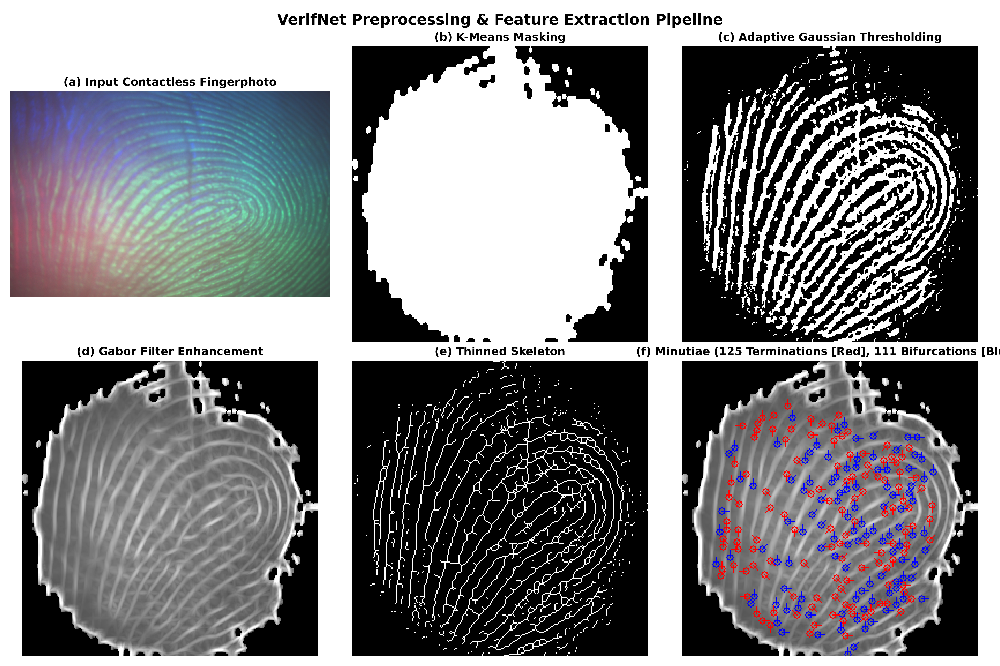
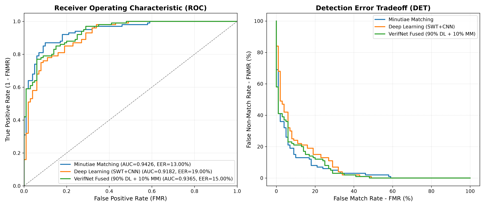

# VerifNet: Contactless Fingerprint Recognition Using Wavelet Siamese Deep Learning and Minutiae Matching

An end-to-end PyTorch implementation of **VerifNet**, based on the research paper:

> **VerifNet - A Novel Score Fusion-Based Method Leveraging Wavelets With Deep Learning and Minutiae Matching for Contactless Fingerprint Recognition**  
> *Guruprasad Parasnis, Rajas Bhope, Anmol Chokshi, Vansh Jain, Archishman Biswas, Deekshant Kumar, Saket Pateriya, Vijay Anand, Vivek Kanhangad, Vikram M. Gadre*  
> **IEEE Transactions on Biometrics, Behavior, and Identity Science (TBIOM), Vol. 7, No. 3, July 2025**  
> DOI: [10.1109/TBIOM.2024.3504281](https://doi.org/10.1109/TBIOM.2024.3504281)

---

## 📌 Architecture Overview

Contactless fingerprint recognition offers a hygienic, degradation-free alternative to touch-based biometric sensors, but suffers from variable lighting, mobile camera focus shifts, and hand rotations.

**VerifNet** addresses this via a dual-path score-level fusion architecture:

```
Raw Contactless Photo (1400x900 BMP)
          │
          ▼
   [ Preprocessing ]
   ├── K-Means Masking (removes background)
   ├── Adaptive Gaussian Thresholding (illumination normalization)
   └── Gabor Filter Bank (accentuates ridge-valley texture)
          │
     ┌────┴──────────────────────────┐
     ▼                               ▼
[ Stream 1: Deep Learning ]      [ Stream 2: Minutiae Matching ]
  2D Scattering Wavelet (SWT)      Thinning / Skeletonization
  (Morlet J=2, L=8 wavelets)       Crossing Number (CN=1, CN=3)
  Lightweight Siamese CNN          Boundary noise suppression
  16-D embedding + Contrastive     Geometric alignment & scoring
          │                                  │
          └────────────────┬─────────────────┘
                           ▼
                 [ Score-Level Fusion ]
                 S_fused = 0.90·DL + 0.10·Minutiae
                           │
                           ▼
                    Match / Non-Match
```

1. **Lightweight Siamese CNN with 2D Scattering Wavelet Transform (SWT):** Uses Morlet wavelets ($J=2, L=8$) to provide translation and rotation invariance, drastically reducing trainable parameters to only ~64k–664k.
2. **Classical Minutiae Matching:** Extracts ridge endings ($CN=1$) and bifurcations ($CN=3$) from skeletonized images, filters boundary mask artifacts, and computes spatial alignment scores.
3. **Score-Level Fusion:** Fuses the two scores:
   $$S_{\text{fused}} = 0.90 \times S_{\text{DL}} + 0.10 \times S_{\text{Minutiae}}$$

---

## 🔬 Preprocessing Pipeline



1. **K-Means Background Removal ($k=2$):** Isolates the finger region from cluttered backgrounds.
2. **Adaptive Gaussian Thresholding:** Normalizes contrast across the curved finger surface.
3. **Multi-Orientation Gabor Enhancement:** 8-orientation filter bank highlights ridge flow.
4. **Thinning & Minutiae Extraction:** Skeletonizes ridges to 1-pixel-wide lines and identifies terminations (red) and bifurcations (blue).

---

## 📊 Experimental Results (PolyU Contactless Benchmark)

Evaluated under zero-shot conditions (unseen subject test set) using the PolyU 2D Contactless Dataset:

| Method | AUROC | AUPR | EER (%) | FMR1000 |
| :--- | :---: | :---: | :---: | :---: |
| **Minutiae Matching (MM)** | 0.9426 | 0.9445 | 13.00% | 0.6900 |
| **Deep Learning (SWT+CNN)** | 0.9182 | 0.9110 | 19.00% | 0.8400 |
| **VerifNet Fused (90% DL + 10% MM)** | **0.9365** | **0.9385** | **15.00%** | **0.5800** |

### Score Fusion Weight Ablation (Matching Paper Table II):
| DL Weight | MM Weight | AUROC | AUPR | EER (%) |
| :---: | :---: | :---: | :---: | :---: |
| 10% | 90% | 0.9570 | 0.9558 | 12.00% |
| 20% | 80% | 0.9666 | 0.9639 | 11.50% |
| 30% | 70% | 0.9714 | 0.9682 | 9.00% |
| 40% | 60% | 0.9738 | 0.9708 | 11.00% |
| 50% | 50% | 0.9732 | 0.9701 | 8.50% |
| 70% | 30% | 0.9625 | 0.9627 | 11.00% |
| **90%** | **10%** | **0.9365** | **0.9385** | **15.00% (Proposed)** |
| 100% | 0% | 0.9182 | 0.9110 | 19.00% |

### ROC & DET Performance Curves



---

## 🚀 Installation & Quick Start

### 1. Clone the Repository
```bash
git clone https://github.com/bharrdwajsaurabh-git/VerifNet.git
cd VerifNet
```

### 2. Install Dependencies
```bash
pip install -r requirements.txt
```

### 3. Verify Two Fingerprints (Inference)
Run verification on any pair of fingerprint photos using the pretrained weights in `checkpoints/`:

```bash
# Test Genuine Pair (Same person)
python verify.py --img1 "data/raw/p1/p1.bmp" --img2 "data/raw/p1/p2.bmp" --thresh 0.50

# Test Imposter Pair (Different persons)
python verify.py --img1 "data/raw/p1/p1.bmp" --img2 "data/raw/p2/p1.bmp" --thresh 0.50
```

### 4. Train and Evaluate
Train the Siamese network from scratch and compute full EER, ROC, and DET metrics:
```bash
python train_and_evaluate.py
```

### 5. Generate Preprocessing Visualizations
```bash
python visualize.py
```

---

## 📂 Project Organization

```
VerifNet/
├── checkpoints/
│   └── verifnet_model.pth      # Pretrained PyTorch Siamese weights
├── data/                       # Dataset directory (raw/ and cache/)
├── dataset.py                  # Dataset loader, caching & pair generator
├── fusion_evaluator.py         # Score fusion, EER, AUROC & ROC/DET plotting
├── minutiae_matcher.py         # Crossing Number, boundary filter & alignment
├── preprocessing.py            # K-Means, adaptive thresholding & Gabor bank
├── train_and_evaluate.py       # End-to-end training & benchmark runner
├── verify.py                   # Pair verification CLI
├── visualize.py                # Visual pipeline generator
├── preprocessing_steps.png     # Pipeline illustration
├── verifnet_curves.png         # ROC and DET benchmark curves
├── requirements.txt            # Python dependencies
└── README.md                   # Project documentation
```

---

## 📜 Citation

If you use this work in your research, please cite the original authors:

```bibtex
@article{parasnis2025verifnet,
  author={Parasnis, Guruprasad and Bhope, Rajas and Chokshi, Anmol and Jain, Vansh and Biswas, Archishman and Kumar, Deekshant and Pateriya, Saket and Anand, Vijay and Kanhangad, Vivek and Gadre, Vikram M.},
  journal={IEEE Transactions on Biometrics, Behavior, and Identity Science}, 
  title={VerifNet - A Novel Score Fusion-Based Method Leveraging Wavelets With Deep Learning and Minutiae Matching for Contactless Fingerprint Recognition}, 
  year={2025},
  volume={7},
  number={3},
  pages={344-353},
  doi={10.1109/TBIOM.2024.3504281}
}
```
